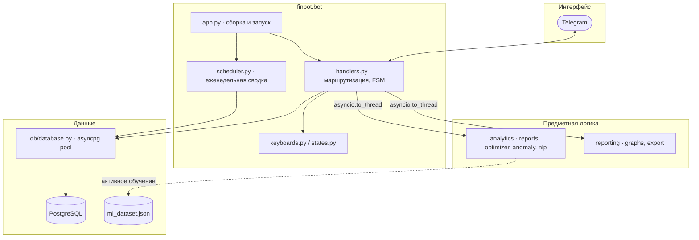
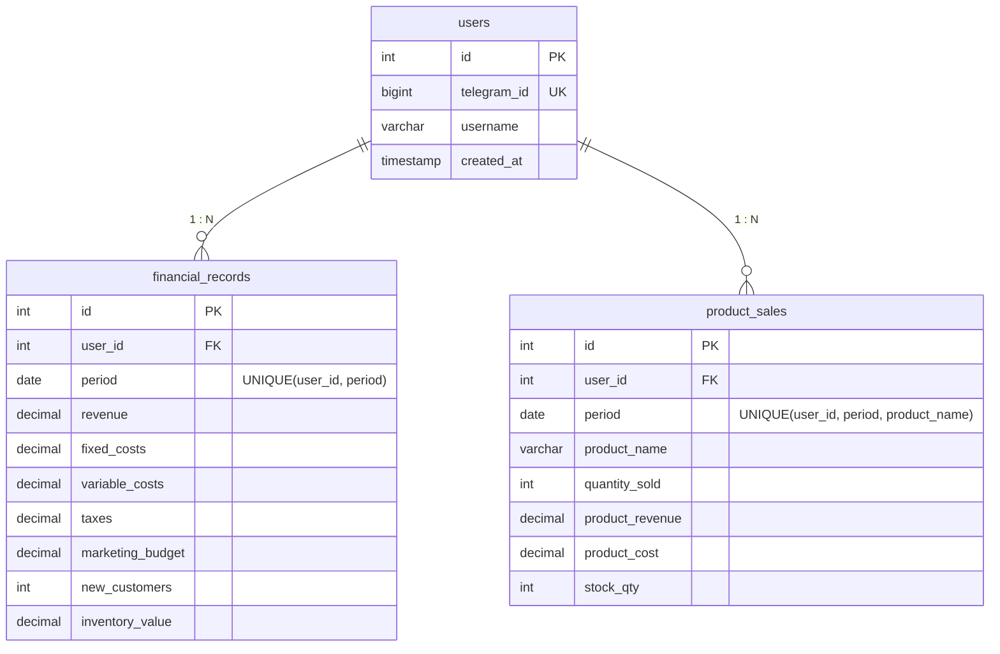
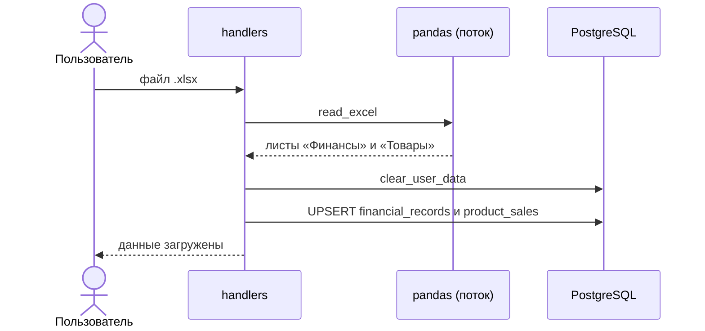
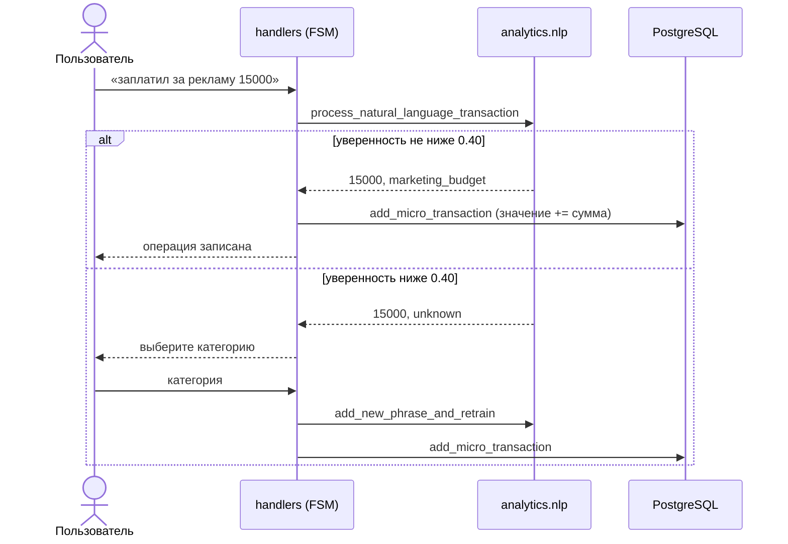

# Архитектура

## 1. Слои

**Принцип:** `analytics` и `reporting` ничего не знают про Telegram и PostgreSQL — принимают списки записей (`dict`-подобные) и возвращают текст/числа/картинки. Поэтому их можно тестировать без бота и БД (см. `tests/`).

## 2. Схема БД

Обе таблицы ссылаются на `users` с `ON DELETE CASCADE`. Запись в обе таблицы идёт через `INSERT … ON CONFLICT DO UPDATE` (UPSERT), поэтому повторная загрузка не создаёт дубликатов.

## 3. Загрузка Excel

Листы определяются по названиям колонок. Старые данные пользователя перед загрузкой удаляются, чтобы модели не смешивали разные отчёты.

## 4. «Быстрая операция» и активное обучение

Текст очищается от цифр, валют и стоп-глаголов («купил», «оплатил»…), затем классифицируется `TfidfVectorizer(analyzer="char_wb", ngram_range=(3, 6)) + MultinomialNB`. Символьные n-граммы нечувствительны к падежам и опечаткам, поэтому лемматизатор не нужен. Обучающая выборка (214 фраз, сбалансирована по классам) лежит в `analytics/nlp_dataset.py`. Новая фраза добавляется в датасет трижды (oversampling), модель переобучается в памяти; датасет ограничен 2000 записей, а исходная выборка `TRAIN_DATA` не изменяется.

## 5. Поиск аномалий

1. Признаки: `revenue`, `variable_costs`, `marketing_budget` (минимум 6 месяцев).
2. `IsolationForest(contamination=0.1, random_state=42)` помечает кандидатов (`-1`).
3. Бизнес-фильтр оставляет только тех, у кого хотя бы одна из метрик отклоняется от среднего более чем на 15 % — это отсекает статистический шум.
4. Для каждой аномалии выбирается текстовая гипотеза по правилам (слив маркетинга, органический рост, кассовый разрыв, сезонный пик, нетипичное соотношение).

## 6. SCM-оптимизация бюджета

- Товары делятся на «якоря» и «аксессуары» по 70-му перцентилю удельной себестоимости.
- Для каждого SKU считается **покрытие склада** (на сколько месяцев хватит остатка) и **коэффициент риска** σ/μ продаж.
- Целевая функция — ожидаемая прибыль с экспоненциальным насыщением спроса, квадратичным штрафом за волатильность и эффектом ореола (маркетинг зависит от вложений в «якоря»).
- Ограничения: сумма долей равна 1; доли в [0, 1]; при покрытии больше 3 мес. доля SKU равна 0, при покрытии 1.5–3 мес. — не более 15 % для «якоря» и 5 % для аксессуара.
- Решатель: `scipy.optimize.minimize(method="SLSQP", maxiter=2000)`.

## 7. Неблокирующая архитектура

Event loop aiogram не должен простаивать на CPU-bound задачах, поэтому парсинг Excel, оптимизация, обучение, рендер графиков и сборка PDF вызываются через `asyncio.to_thread`. Графики и PDF собираются в `io.BytesIO` и отправляются без записи на диск (кроме временных файлов для `fpdf`, которые удаляются сразу после сборки).

## 8. Возможные улучшения

- Разнести `handlers.py` на несколько `Router` по функциональным блокам (загрузка, аналитика, ML, NLP).
- Хранить NLP-словарь в БД по `user_id`.
- Миграции схемы (Alembic).
- Сезонно-устойчивая детекция аномалий.
